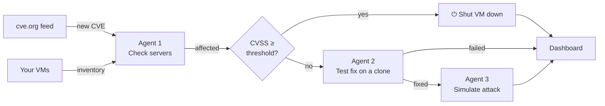

<div align="center">

# 🛡️ eleven0zero

**A CVE is published → affected VMs are found → the fix is tested → the exploit is re-run. Automatically.**


*Built at the GenAI Summit Hackathon.*

</div>

---

## Why

Dozens of CVEs are published every day. For each one someone has to answer: **Are we affected? What's the fix? Does it work?** That takes hours per CVE. eleven0zero answers all three in minutes, without touching production.

## How it works



| | Step | What happens |
|---|---|---|
| 📡 | **Watch** | Polls the [CVEProject](https://github.com/CVEProject/cvelistV5) delta log every minute. |
| 🔍 | **Inventory** | Collects packages, ports, services and containers from each VM over SSH or boxd. |
| ⚖️ | **Judge** | Every CVE is judged against every VM by one or more LLMs. Majority vote wins. |
| ⏻ | **Shut down** | If an affected VM's CVSS score is at or above the threshold, it is powered off immediately. |
| 🧪 | **Test fix** | Otherwise the VM is snapshotted with [boxd](https://boxd.sh), the AI-planned fix runs on a clone, and services are re-checked. |
| 💥 | **Simulate attack** | A non-destructive PoC runs from an isolated attacker VM against the patched clone. |

## Dashboard

| Tab | Shows |
|---|---|
| **Dashboard** | CVE feed, VMs, and every finding with votes, fix commands and exploit result. |
| **Graphics** | A live, plain-English view of the three agents at work, with an agent terminal streaming each step. |
| **Settings** | Judge, remediation and exploit models, the CVSS shutdown threshold, and which VMs may be shut down. |

## Guardrails

- Fixes and exploits run only on **disposable, isolated clones**.
- Auto-shutdown applies only to the VMs you select, and can be turned off.
- Generated commands that touch firewalls or power state are **blocked**.
- Every generated exploit is **saved for review**.
- The dashboard has no auth, so it binds to **localhost only**.

## Quick start

You need Docker, SSH access to your VMs, and optionally the [boxd CLI](https://boxd.sh) for fix and exploit tests.

```bash
cp .env.example .env          # fill in GOOGLE_API_KEY (+ BOXD_TOKEN, VENICE_API_KEY)
docker compose up --build -d
```

Open **http://localhost:5000** and add hosts such as `vm-1.boxd`, `root@10.0.0.5` or `user@host:2222`.

### Demo

```bash
docker compose -f docker-compose-demo.yml up --build --force-recreate -d
```

This serves a mock CVE feed (`demo/mock_cve_api.py`), resets the boxd demo VMs and database, and adds three hosts:

| VM | Expected result |
|---|---|
| `hackathon-vm-1` | ✅ not affected |
| `hackathon-vm-2` | ✅ not affected |
| `hackathon-vulnerable-vm` (`pyyaml` 5.3.1) | 🚨 affected by CVE-2020-14343 → fix tested → patched snapshot saved |

## Configuration

| Variable | Purpose |
|---|---|
| `GOOGLE_API_KEY` | **Required.** Gemini, the default judge |
| `BOXD_TOKEN` | Snapshots and clones for fix tests |
| `VENICE_API_KEY` | Exploit PoC generation and `venice:` judge models |
| `GEMINI_MODEL` | Override the default Gemini model |
| `SSH_DIR` / `BOXD_DIR` | Key folders mounted read-only (defaults: `~/.ssh`, `~/AppData/Roaming/boxd`) |

Polling intervals live in [`backend/config/config.py`](backend/config/config.py).

## Project layout

```
backend/eleven0zero/   collector · engine (feed → judge → shutdown/fix → exploit) · tasks · API
frontend/src/          React dashboard, graphics view, agent terminal
tools/                 setup_vms · rebuild · delete_all_vms
demo/                  mock CVE API
```

## Development

```bash
cd backend && pip install -r requirements.txt
CELERY_EAGER=1 python manage.py migrate && CELERY_EAGER=1 python manage.py runserver
python manage.py test

cd frontend && npm install && npm run dev
```

## Known limits

- LLM cost grows with CVEs × VMs × models.
- "Exposed" ports mean bound to all interfaces. Firewalls aren't checked.
- Fix and exploit tests need boxd VMs.
