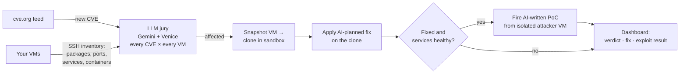

<div align="center">

# 🛡️ eleven0zero — CVE Watchdog

**From "a CVE was just published" to "this fix is tested and the exploit no longer works" — automatically.**


*Built at the GenAI Summit Hackathon.*

</div>

---

## The problem

Dozens of CVEs are published every day. For each one, someone has to answer three questions:

1. **Are we affected?** Which of our machines actually run the vulnerable component?
2. **What's the fix?** And will applying it break anything?
3. **Does the fix work?** Is the machine still exploitable afterwards?

Today that is hours of manual triage per CVE. CVE Watchdog does all three on its own, in minutes, without touching production.

## How it works



| Step | What happens |
|---|---|
| 📡 **Watch** | Polls the official [CVEProject](https://github.com/CVEProject/cvelistV5) delta log every minute. |
| 🔍 **Inventory** | SSHes into each VM with a stdlib-only collector: OS packages (dpkg/rpm), pip/npm packages, listening ports, running services, Docker containers. |
| ⚖️ **Judge** | Every new CVE is judged against every VM. One or more models vote `affected` / `likely` / `not_affected` with evidence and actions. Majority wins; disagreement lowers confidence. Components whose names match the CVE are highlighted in the prompt; if none match, the model gets the full inventory to catch aliases (e.g. `httpd` = Apache HTTP Server). |
| 🧪 **Fix test** | For affected VMs: snapshot via [boxd](https://boxd.sh), boot an isolated clone, run the model's fix commands, then re-inventory and check no service broke. Production is never touched. |
| 💥 **Exploit check** | If the fix passed, a model writes a non-destructive proof-of-concept, which runs from a throwaway attacker VM on a private network against the patched clone. Everything is destroyed afterwards. |
| 📊 **Report** | A live dashboard shows each finding, the votes, the commands run, and whether the exploit still lands. |

### Guardrails

- Fixes and exploits only ever run on **disposable, isolated clones**, never on your VMs.
- Generated commands that touch firewalls or power state are **blocked**.
- Host strings are validated before reaching `ssh` so input can't become an SSH option.
- Every generated exploit is **saved for admin review**, whatever the result.
- The dashboard has no auth, so it binds to **localhost only**.

## Architecture

```
┌──────────── docker compose ─────────────────────────────────────────┐
│  watchdog            Django API + React dashboard   :5000 (local)   │
│  worker              Celery: CVE evaluation, LLM calls (×4)         │
│  worker-remediation  Celery: snapshot/clone/exploit tests (×1)      │
│  beat                Celery: schedules the CVE feed poll            │
│  redis               broker                                         │
└─────────────────────────────────────────────────────────────────────┘
         │ SSH                     │ boxd CLI               │ HTTPS
         ▼                         ▼                        ▼
     your VMs            snapshots · clones        Gemini · Venice AI
```

```
backend/
  config/            Django settings, Celery app, timing config loader
  watchdog/
    collector.py     runs on the VM over SSH, prints a JSON inventory
    engine.py        feed → judge → remediate → exploit
    tasks.py         Celery tasks
    views.py         JSON API for the dashboard
  watchdog.toml      poll and scan intervals
frontend/            React + Vite + Tailwind dashboard
setup-vms.*          creates 3 demo VMs (one deliberately vulnerable)
rebuild.*            full reset: VMs, snapshots, database, containers
```

## Quick start

**Prerequisites:** Docker, SSH access to the VMs you want to watch, and optionally the [boxd CLI](https://boxd.sh) for fix and exploit tests.

```bash
# 1. Configure keys
cp .env.example .env        # then fill in GOOGLE_API_KEY (+ BOXD_TOKEN, VENICE_API_KEY)

# 2. (optional) Create the demo VMs on boxd
./setup-vms.sh              # Windows: powershell -ExecutionPolicy Bypass -File .\setup-vms.ps1

# 3. Run
docker compose up --build -d
```

Open **http://localhost:5000**, add hosts (e.g. `keen-pond.boxd`, `root@10.0.0.5`, `user@host:2222`) and watch findings arrive.

> Your `~/.ssh` and boxd key folders are mounted read-only into the containers. Hosts defined in `~/.ssh/config` work by alias.

### Demo scenario

`setup-vms` creates three machines:

| VM | Setup | Expected result |
|---|---|---|
| `keen-pond` | clean | ✅ not affected |
| `free-sky` | clean | ✅ not affected |
| `cve-2024-6387-lab` | isolated, PyYAML 5.3.1 | 🚨 affected by CVE-2020-14343 → fix tested → exploit re-run |

To trigger it right away, open the dashboard and analyze `CVE-2020-14343`.

## Configuration

| Variable | Required | Purpose |
|---|---|---|
| `GOOGLE_API_KEY` | ✅ | Gemini, the default judge |
| `GEMINI_MODEL` | | Override the default Gemini model |
| `BOXD_TOKEN` | for fix tests | Snapshot and clone VMs |
| `VENICE_API_KEY` | for exploit tests | PoC generation, and `venice:` judge models |
| `SSH_DIR` / `BOXD_DIR` | | Key folders to mount (defaults: `~/.ssh`, `~/AppData/Roaming/boxd`) |

Timing lives in [`backend/watchdog.toml`](backend/watchdog.toml). Edit it, then run `docker compose restart`:

```toml
[cve_feed]
poll_seconds = 60        # how often to check cve.org
lookback_minutes = 60    # on start, also evaluate the last N minutes

[vm_scan]
interval_seconds = 600   # how often to re-collect VM inventories
```

Judge, remediation and exploitation models can be chosen in the dashboard's **Settings** page.

## Development

```bash
# backend (eager mode runs Celery tasks inline, no Redis needed)
cd backend && pip install -r requirements.txt
CELERY_EAGER=1 python manage.py migrate && CELERY_EAGER=1 python manage.py runserver

# frontend
cd frontend && npm install && npm run dev

# tests
cd backend && python manage.py test && python config/intervals.py
```

To start over completely (demo VMs, **all** boxd snapshots, database), run `./rebuild.sh` or `rebuild.ps1`.

## Known limits

- LLM cost grows with CVEs × VMs × models: every pair is a call. Use a cheap judge model if feed volume hurts.
- "Exposed" ports mean bound to all interfaces. Firewalls and cloud security groups aren't checked.
- Fix and exploit tests require boxd VMs, because they depend on snapshots.
